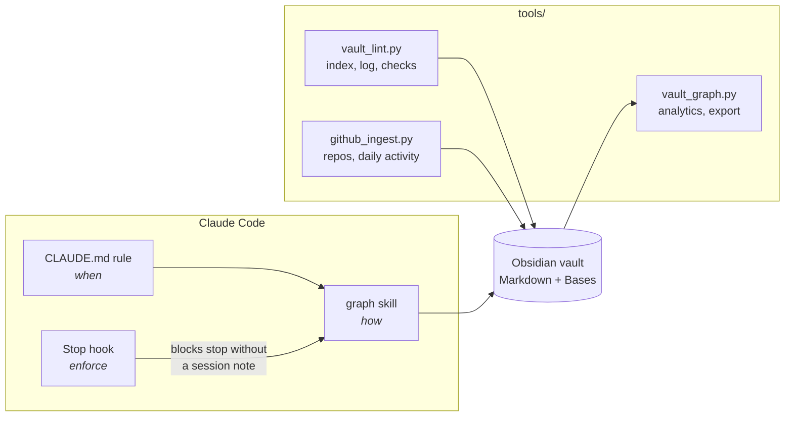

# claude-activity-graph

A coding agent that keeps its own engineering record as a typed knowledge graph.

Every session I run with Claude Code reads from and writes to an Obsidian vault: tasks change status, decisions get recorded with the options I rejected, failures become lessons linked to the task that taught them, and each session closes with a note that links everything it touched. The vault is plain Markdown, so I browse it in Obsidian's graph view; the agent reads `index.md` and the lesson notes before it starts work, so the next session starts from what the last one learned.

This repo is the system without my data: the agent rule, the skill, the enforcement hook, the tooling, an empty vault scaffold, and a synthetic example vault.

[Interactive graph of the example vault](docs/index.html) · `python3 tools/vault_graph.py --vault example-vault stats`

## Why

Agent memory is usually a flat file of facts. That works for preferences, but it breaks down for engineering work, where the useful part is the relationships: *this* lesson came from *that* failed task, *this* decision was made for *that* feature and should be revisited if *this* number moves. When it's flat, the agent can't follow the chain from a symptom to a lesson it learned last week in a different repo.

So the memory is a graph:

- **Nodes** are notes, typed by a `type` frontmatter key: `project`, `task`, `lesson`, `decision`, `session`, `reference`, `raw`, `repo`, `activity`.
- **Edges** are wiki links, typed by where they appear. A link in a lesson's `source:` key is a *taught-by* edge; a link in a session's `touched:` list is a *worked-on* edge; a link in the body is a plain *mention*. No separate schema file: the templates are the schema, and the lint checks them.

## Architecture

Four layers, each with one job:



| Layer | File | Job |
|---|---|---|
| Rule | `claude/CLAUDE.md.snippet` | Always loaded. Says *when* to write: on task stage changes, real decisions, repeatable failures, and at session end. Short on purpose; it's in every context window. |
| Skill | `claude/skills/graph/SKILL.md` | Loaded on demand. Says *how*: new project, ingest a source, close a session, weekly rollup, move the vault. |
| Hook | `claude/hooks/session_note_check.py` | A Stop hook. If the transcript shows real edits and there is no session note from today, it exits 2 and the agent writes one before stopping. Rules get skipped; hooks don't. |
| Tools | `tools/` | Deterministic upkeep the model shouldn't do by hand: index rebuild, link checks, GitHub ingest, graph analytics. Stdlib Python only. |

## The learning loop

The point of the graph is that lessons travel. `vault_graph.py stats` on the example vault:

```
36 nodes, 100 edges, density 0.0794
1 weakly connected components, largest 34 nodes

Edges by label (frontmatter key, or 'mentions' for body links)
  mentions   57
  touched    23
  repo       10
  source     6
  ...

Learning loop
  lessons            6  (1 enforced by a script, auto: true)
  tasks that taught  5 of 8
  lessons applied outside their home project  3
    inference-gateway/lessons/cache-keys-include-model-version  <- rag-service
    shared/lessons/checks-beat-checklists  <- rag-service
    shared/lessons/reproduce-before-fixing  <- inference-gateway
```

The last block is the one I care about. In the example, a cache bug in the gateway project ("key on the resolved model revision, never an alias") becomes a lesson, and a week later the RAG project's embedding cache is built on it. That's the pattern I see in my own vault: the agent reads the relevant lesson notes before starting work, and the lesson's `source` link tells it why the rule exists, so it can judge whether it applies.

`auto: true` marks lessons that a test or CI job now enforces. The lesson I apply most is [checks-beat-checklists](example-vault/shared/lessons/checks-beat-checklists.md): when a lesson can become a check, it should, and the note records that it did.

## Design decisions

**Plain Markdown, not a database.** The agent already reads and writes files well; a graph DB would need a tool layer and would hide the data from me. Obsidian gives me a graph view and [Bases](https://help.obsidian.md/bases) tables (`Lessons.base`, `Tasks.base`, ...) over the same files for free. The cost is that queries are scripts, not Cypher, and at a few thousand notes that's fine.

**The templates are the schema.** Frontmatter keys are fixed per type, and the lint enforces the ones that carry edges: a lesson without a `source` link, or a task without a `status`, is an error. Edge labels come from the key, so adding an edge type means adding a key to a template, with no migration.

**Rule, skill, hook, tool: in that order of trust.** The rule is cheap but advisory. The skill holds procedure so the rule can stay short. The hook exists because "write a session note at the end" was the first instruction to get dropped on long sessions. Anything mechanical (index, links, GitHub) is a script, because the model doing it by hand costs tokens and is still wrong sometimes.

**Raw sources are immutable.** Pasted docs, specs and review comments go in `raw/` unchanged, and compiled notes link back to them. When a lesson turns out to be wrong, I can see what it was compiled from. This is Karpathy's LLM-wiki split between sources and the compiled wiki (credits below).

**Machine-written notes have a human-owned tail.** `github_ingest.py` regenerates repo and activity notes on every run but keeps everything below `## Notes`. Reruns are idempotent and never eat my annotations.

**Links resolve exact path first, then by name.** Every project has a `project.md`; `[[rag-service/project]]` must not count as an inbound link to every project note. The original version of my lint resolved by filename only and over-counted hubs.

**One pointer file.** The vault path lives in exactly one place (`~/.claude/tools/vault_path`, or `$CLAUDE_GRAPH_VAULT`). Moving from iCloud to Obsidian Sync means changing one line, and project-specific skills read the pointer instead of hard-coding the path.

More on the trade-offs, and what I'd change, in [docs/design.md](docs/design.md).

## Quickstart

```bash
git clone https://github.com/cjanowski/claude-activity-graph
cd claude-activity-graph
./install.sh ~/notes/engineering        # tools, hook, skill -> ~/.claude; scaffolds the vault
```

The installer doesn't touch `settings.json` or `CLAUDE.md`. It prints the hook block and the rule snippet to merge yourself. Then open the vault in Obsidian and start a Claude Code session anywhere.

Try the tools on the example vault without installing:

```bash
python3 tools/vault_lint.py  --vault example-vault --check      # exit 1 on any problem
python3 tools/vault_graph.py --vault example-vault stats
python3 tools/vault_graph.py --vault example-vault mermaid --project rag-service
python3 tools/vault_graph.py --vault example-vault html -o graph.html
python3 -m unittest discover -s tests
```

## Layout

```
claude/
  CLAUDE.md.snippet          always-on rule
  skills/graph/SKILL.md      procedures
  hooks/session_note_check.py
  settings.hooks.json        Stop hook registration
tools/
  vaultlib.py                vault discovery, frontmatter parser, typed-edge graph model
  vault_lint.py              checks + index.md + log.md (--check for CI)
  vault_graph.py             stats / json / mermaid / html export
  github_ingest.py           gh CLI -> repo and daily activity notes
  graph_template.html        d3 force-directed explorer
vault-template/              empty vault: templates, Bases, README, log
example-vault/               synthetic vault: two AI-infra projects, ~3 weeks of sessions
docs/                        design notes, rendered example graph
tests/                       unittest: parser, graph, lint, hook
```

## Credits

- **Andrej Karpathy**: the LLM-wiki pattern this is built around. Immutable raw sources, a wiki the LLM compiles and maintains from them, an `index.md` catalog and an append-only `log.md`, and periodic lint passes. His framing of the LLM as the wiki's maintainer, not just its reader, is the core idea here. ([gists](https://gist.github.com/karpathy))
- **[Claude Code](https://docs.anthropic.com/en/docs/claude-code)** by Anthropic: the agent runtime. `CLAUDE.md` memory, Skills and Stop hooks are the three extension points this uses. The lesson format (a rule, then **Why:** and **How to apply:**) is adapted from Claude Code's memory-note convention.
- **[Obsidian](https://obsidian.md)** and its Bases core plugin: graph view and table views over plain Markdown.
- **[d3](https://d3js.org)** (Mike Bostock and contributors): force layout in the graph explorer.
- **[GitHub CLI](https://cli.github.com)**: the data source for `github_ingest.py`.
- The categorical palette in the explorer follows a colour-vision-deficiency-checked ordering, with shape as a second encoding so no type relies on colour alone.

## License

MIT
